<picture>
  <source media="(prefers-color-scheme: dark)" srcset=".github/assets/header-dunkel.svg">
  
</picture>

     

<h3 align="center">Give your agents hands: apps, browsers, screens and the web.</h3>

The tool layer of an agent stack: the Model Context Protocol and its SDKs, MCP servers sorted by the app they open up, integration platforms, agent-native CLIs, browser and computer use, LLM-ready web data and n8n workflows. Each repo is filed by what it lets an agent do.

## Start here

No time for 240 repos? Start with these 4, one per role. Add the rest when you feel the gap.

| Role | Pick | Why |
|:--|:--|:--|
| **Build** | [fastmcp](https://github.com/PrefectHQ/fastmcp) `★ 28.2k` | Write your own MCP server or client in a few lines of Python |
| **Connect** | [composio](https://github.com/ComposioHQ/composio) `★ 30.8k` | Plug agents into 1000+ app toolkits with authentication handled |
| **Browse** | [playwright-mcp](https://github.com/microsoft/playwright-mcp) `★ 38.8k` | Give any MCP agent a real browser to click, type and read pages |
| **Web data** | [firecrawl](https://github.com/firecrawl/firecrawl) `★ 196.4k` | Turn websites into clean, LLM-ready markdown and structured data |

<picture>
  <source media="(prefers-color-scheme: dark)" srcset=".github/assets/map-dunkel.svg">
  
</picture>

## Contents

- [MCP foundations](#mcp-foundations) · 38 [Spec, SDKs and frameworks](#spec-sdks-and-frameworks) · [Gateways, registries and managers](#gateways-registries-and-managers) · [Other agent protocols](#other-agent-protocols) · [MCP directories](#mcp-directories)
- [MCP servers](#mcp-servers) · 68 [Developer and infrastructure servers](#developer-and-infrastructure-servers) · [Work and business app servers](#work-and-business-app-servers) · [Notes and knowledge servers](#notes-and-knowledge-servers) · [Creative, CAD and maker servers](#creative-cad-and-maker-servers) · [Other models as tools](#other-models-as-tools)
- [Connectors and agent CLIs](#connectors-and-agent-clis) · 19 [Integration, auth and wallet platforms](#integration-auth-and-wallet-platforms) · [CLIs built for agents](#clis-built-for-agents)
- [Browser agents](#browser-agents) · 36 [Autonomous browser agents](#autonomous-browser-agents) · [Browser control for agents](#browser-control-for-agents) · [AI testing and recorded workflows](#ai-testing-and-recorded-workflows)
- [Computer and phone use](#computer-and-phone-use) · 32 [Desktop computer use](#desktop-computer-use) · [Phone and mobile use](#phone-and-mobile-use)
- [Web data for LLMs](#web-data-for-llms) · 29 [Crawlers and extractors](#crawlers-and-extractors) · [Search for agents](#search-for-agents) · [Video and social readers](#video-and-social-readers)
- [Workflow pipes](#workflow-pipes) · 18 [n8n ecosystem](#n8n-ecosystem) · [Workflow template libraries](#workflow-template-libraries)

## MCP foundations

The protocol, SDKs, gateways and directories.

### Spec, SDKs and frameworks

- **[inspector](https://github.com/modelcontextprotocol/inspector)** `★ 11.2k` · **Top pick.** Testing and debugging tools for MCP servers, with a CLI and a TUI.
- **[servers](https://github.com/modelcontextprotocol/servers)** `★ 91.6k` · Official reference implementations of MCP servers.
- **[fastmcp](https://github.com/PrefectHQ/fastmcp)** `★ 28.2k` · Pythonic framework for building MCP servers and clients.
- **[python-sdk](https://github.com/modelcontextprotocol/python-sdk)** `★ 24.7k` · Official Python SDK for building MCP servers and clients.
- **[mcp-for-beginners](https://github.com/microsoft/mcp-for-beginners)** `★ 17.5k` · Open-source curriculum on the Model Context Protocol with cross-language, real-world examples.
- **[typescript-sdk](https://github.com/modelcontextprotocol/typescript-sdk)** `★ 13.7k` · Official TypeScript SDK for building MCP servers and clients.
- **[modelcontextprotocol](https://github.com/modelcontextprotocol/modelcontextprotocol)** `★ 9.6k` · Specification and documentation for the Model Context Protocol.
- **[mcp-agent](https://github.com/lastmile-ai/mcp-agent)** `★ 8.6k` · Framework for building agents on the Model Context Protocol with simple workflow patterns.
- **[mcpb](https://github.com/modelcontextprotocol/mcpb)** `★ 2.2k` · Desktop Extensions for one-click installation of local MCP servers.
- **[mcp-extensions](https://github.com/openai/mcp-extensions)** `★ 1.1k` · OpenAI's MCP extensions for building plugins that feel like native ChatGPT features.
- **[automcp](https://github.com/NapthaAI/automcp)** `★ 301` · Converts tools, agents and orchestrators from existing agent frameworks into MCP servers.
- **[anubis-mcp](https://github.com/zoedsoupe/anubis-mcp)** `★ 181` · Elixir SDK for the Model Context Protocol, forked from hermes-mcp.
- **[modex](https://github.com/theronic/modex)** `★ 121` · Clojure MCP library for giving AI models tools, resources and prompts.
- **[mcp-server](https://github.com/AI-FOR-DEVS/mcp-server)** `★ 5` · Demo MCP server with a note:// scheme, an add-note tool and a summarize-notes prompt.

### Gateways, registries and managers

- **[mcp-context-forge](https://github.com/IBM/mcp-context-forge)** `★ 4.7k` · **Top pick.** AI gateway, registry and proxy that puts MCP, A2A and REST or gRPC APIs behind one endpoint.
- **[registry](https://github.com/modelcontextprotocol/registry)** `★ 7.4k` · Community-driven registry service for MCP servers.
- **[archestra](https://github.com/archestra-ai/archestra)** `★ 4.4k` · Enterprise AI platform combining guardrails, an MCP registry, a gateway and an orchestrator.
- **[jarvis-registry](https://github.com/ascending-llc/jarvis-registry)** `★ 3.7k` · MCP and agent gateway that connects AI copilots and agents to enterprise tools.
- **[mcp-proxy](https://github.com/sparfenyuk/mcp-proxy)** `★ 2.8k` · Bridge between Streamable HTTP and stdio MCP transports.
- **[MCP-SuperAssistant](https://github.com/srbhptl39/MCP-SuperAssistant)** `★ 2.6k` · Brings MCP to ChatGPT, DeepSeek, Perplexity, Grok, Gemini and other chat sites.
- **[mcp-installer](https://github.com/anaisbetts/mcp-installer)** `★ 1.5k` · MCP server that installs other MCP servers for you.
- **[agentweave](https://github.com/sauravsingla/agentweave)** `★ 42` · Narrows the candidate tools and agents for MCP and A2A systems before the model call.
- **[omnimcp](https://github.com/milkymap/omnimcp)** `★ 30` · Semantic router that discovers and runs tools across multiple MCP servers.

### Other agent protocols

- **[A2A](https://github.com/a2aproject/A2A)** `★ 26.3k` · Open protocol for communication and interoperability between opaque agentic applications.
- **[ag-ui](https://github.com/ag-ui-protocol/ag-ui)** `★ 16.9k` · Agent-User Interaction Protocol for bringing AI agents into front-end applications.
- **[webmachinelearning/webmcp](https://github.com/webmachinelearning/webmcp)** `★ 4.8k` · Specification for WebMCP, a way for web pages to expose tools to AI agents.
- **[opengap](https://github.com/open-gitagent/opengap)** `★ 3k` · Framework-agnostic, git-native standard for defining AI agents.
- **[MiguelsPizza/WebMCP](https://github.com/MiguelsPizza/WebMCP)** `★ 1.1k` · Brings the Model Context Protocol to the web.
- **[webmcp-tools](https://github.com/GoogleChromeLabs/webmcp-tools)** `★ 733` · Developer utilities and demos that support adoption of the WebMCP API.
- **[agent-exchange](https://github.com/open-experiments/agent-exchange)** `★ 363` · Platform for agent discovery and work exchange.
- **[awesome-webmcp](https://github.com/yigitkonur/awesome-webmcp)** `★ 31` · Curated list of WebMCP resources, the web standard for exposing site tools to AI agents.
- **[A2AMCP](https://github.com/webdevtodayjason/A2AMCP)** `★ 21` · MCP communication server for agents, based on the concept of Google's Agent2Agent protocol.
- **[web-mcp](https://github.com/AgriciDaniel/web-mcp)** `★ 17` · Skill that helps decide if a site should expose WebMCP tools to agents and design them safely.

### MCP directories

- **[punkpeye/awesome-mcp-servers](https://github.com/punkpeye/awesome-mcp-servers)** `★ 97k` · **Top pick.** Large collection of MCP servers.
- **[wong2/awesome-mcp-servers](https://github.com/wong2/awesome-mcp-servers)** `★ 4.4k` · Curated list of Model Context Protocol servers.
- **[microsoft/mcp](https://github.com/microsoft/mcp)** `★ 3.8k` · Catalog of official Microsoft MCP servers for AI-powered data access and tool integration.
- **[awesome-remote-mcp-servers](https://github.com/jaw9c/awesome-remote-mcp-servers)** `★ 1.2k` · Curated list of remote MCP servers.
- **[official-mcp-servers](https://github.com/VoltAgent/official-mcp-servers)** `★ 401` · Curated directory of 390+ official MCP servers from the companies behind the products.

<a href="#contents">back to contents</a>

## MCP servers

One app or system, plugged into any agent.

### Developer and infrastructure servers

- **[github-mcp-server](https://github.com/github/github-mcp-server)** `★ 34k` · **Top pick.** GitHub's official MCP server.
- **[DesktopCommanderMCP](https://github.com/wonderwhy-er/DesktopCommanderMCP)** `★ 10.2k` · MCP server that gives Claude terminal control, file search and diff-based file editing.
- **[devspace](https://github.com/Waishnav/devspace)** `★ 5.3k` · Self-hosted MCP server that lets ChatGPT and other agents read, edit and run code on your machine.
- **[dbhub](https://github.com/bytebase/dbhub)** `★ 3.7k` · Token-conscious MCP server for Postgres, MySQL, SQL Server, Oracle, MariaDB and SQLite.
- **[kaguya](https://github.com/ykdojo/kaguya)** `★ 1.2k` · Inactive ChatGPT plugin that loads and edits local files and runs Python, JavaScript and bash.
- **[db-mcp-server](https://github.com/FreePeak/db-mcp-server)** `★ 474` · MCP server that gives AI assistants structured access to multiple databases.
- **[mcp-server-tauri](https://github.com/hypothesi/mcp-server-tauri)** `★ 329` · MCP server and plugin for Tauri v2 development.
- **[aws-mcp](https://github.com/RafalWilinski/aws-mcp)** `★ 296` · MCP server that lets Claude work with your AWS account.
- **[portainer-mcp](https://github.com/portainer/portainer-mcp)** `★ 239` · Official MCP server for managing Portainer container environments from an LLM.
- **[tailscale-mcp](https://github.com/HexSleeves/tailscale-mcp)** `★ 146` · MCP server that wraps Tailscale's CLI and REST API for automated network management.
- **[tauri-plugin-mcp](https://github.com/P3GLEG/tauri-plugin-mcp)** `★ 112` · Lets agents like Cursor and Claude Code debug Tauri apps through screenshots, windows and the DOM.
- **[mcp-rdf-explorer](https://github.com/emekaokoye/mcp-rdf-explorer)** `★ 56` · MCP server for conversational exploration of RDF knowledge graphs in files or SPARQL endpoints.
- **[hyperlane-mcp](https://github.com/Suryansh-23/hyperlane-mcp)** `★ 7` · MCP server for the Hyperlane protocol, covering cross-chain messaging.

### Work and business app servers

- **[notion-mcp-server](https://github.com/makenotion/notion-mcp-server)** `★ 4.7k` · **Top pick.** Official MCP server for Notion.
- **[whatsapp-mcp](https://github.com/lharries/whatsapp-mcp)** `★ 6.8k` · MCP server for WhatsApp.
- **[google-analytics-mcp](https://github.com/googleanalytics/google-analytics-mcp)** `★ 3.6k` · MCP server that lets agents query Google Analytics.
- **[mcp-gsc](https://github.com/AminForou/mcp-gsc)** `★ 2.1k` · MCP server that brings Google Search Console insights into Claude for SEO work.
- **[atlassian-mcp-server](https://github.com/atlassian/atlassian-mcp-server)** `★ 1.1k` · Official remote MCP server that connects agents to Jira, Confluence and Bitbucket.
- **[work-iq](https://github.com/microsoft/work-iq)** `★ 1k` · Microsoft's MCP server, CLI and Copilot plugins that connect agents to Microsoft 365 data.
- **[mcp-notion-server](https://github.com/suekou/mcp-notion-server)** `★ 925` · MCP server that connects Notion to MCP-compatible clients.
- **[yutu](https://github.com/eat-pray-ai/yutu)** `★ 710` · CLI, MCP server and AI agent that automate YouTube workflows.
- **[claude-code-notion-plugin](https://github.com/makenotion/claude-code-notion-plugin)** `★ 500` · Plugin that connects Claude Code to Notion.
- **[mcp-google-map](https://github.com/cablate/mcp-google-map)** `★ 485` · MCP server with 18 Google Maps tools and 3 agent skills for places, routes and travel planning.
- **[outlook-mcp](https://github.com/ryaker/outlook-mcp)** `★ 449` · MCP server that lets Claude read Outlook data through the Microsoft Graph API.
- **[mcp-server-odoo](https://github.com/ivnvxd/mcp-server-odoo)** `★ 407` · MCP server that lets AI assistants securely work with Odoo ERP systems.
- **[shopify-mcp](https://github.com/GeLi2001/shopify-mcp)** `★ 239` · MCP server for the Shopify API, usable from Claude, Cursor and other MCP hosts.
- **[wp-mcp-ultimate](https://github.com/AgriciDaniel/wp-mcp-ultimate)** `★ 169` · MCP server that gives AI assistants 58 WordPress abilities.
- **[sharepoint-mcp](https://github.com/DEmodoriGatsuO/sharepoint-mcp)** `★ 94` · MCP connector that gives LLM applications access to SharePoint documents.
- **[mcp-google-ads](https://github.com/FGRibreau/mcp-google-ads)** `★ 68` · MCP server for full Google Ads campaign management with safety guardrails.
- **[instagram-mcp](https://github.com/mcpware/instagram-mcp)** `★ 66` · MCP server with 23 Instagram Graph API tools for posts, comments, DMs, stories and analytics.
- **[clickup-mcp](https://github.com/hauptsacheNet/clickup-mcp)** `★ 49` · MCP server that gives agents access to ClickUp.

### Notes and knowledge servers

- **[paper-search-mcp](https://github.com/openags/paper-search-mcp)** `★ 2.9k` · MCP server, CLI and skills for finding and downloading papers from arXiv, PubMed, bioRxiv and more.
- **[mcp-everything-search](https://github.com/mamertofabian/mcp-everything-search)** `★ 367` · MCP server that exposes Everything file search to agents.
- **[paperless-mcp](https://github.com/nloui/paperless-mcp)** `★ 247` · MCP server that lets agents work with documents in a Paperless-NGX archive.
- **[agentwikis-mcp](https://github.com/tonbistudio/agentwikis-mcp)** `★ 16` · Read-only MCP server for Agent Wikis, maintained knowledge bases that agents can read.

### Creative, CAD and maker servers

- **[Figma-Context-MCP](https://github.com/GLips/Figma-Context-MCP)** `★ 16.1k` · **Top pick.** MCP server that gives coding agents like Cursor access to Figma layout data.
- **[magic-mcp](https://github.com/21st-dev/magic-mcp)** `★ 6.3k` · MCP server to search 10,000+ React and Tailwind components and generate UI from your editor.
- **[ha-mcp](https://github.com/homeassistant-ai/ha-mcp)** `★ 5.3k` · Unofficial MCP server for Home Assistant.
- **[davinci-resolve-mcp](https://github.com/samuelgursky/davinci-resolve-mcp)** `★ 3.8k` · MCP server integration for DaVinci Resolve Studio.
- **[KiCAD-MCP-Server](https://github.com/mixelpixx/KiCAD-MCP-Server)** `★ 3k` · MCP server that lets Claude and other LLMs work directly in KiCAD.
- **[MeiGen-AI-Design-MCP](https://github.com/jau123/MeiGen-AI-Design-MCP)** `★ 1.8k` · MCP server for finding inspiration and creating images and videos with AI models.
- **[solidworks-automation-skill](https://github.com/wzyn20051216/solidworks-automation-skill)** `★ 1.6k` · AI skill and MCP toolkit for agent-driven automation of desktop CAD such as SolidWorks.
- **[unreal-engine-mcp](https://github.com/flopperam/unreal-engine-mcp)** `★ 1.1k` · MCP server for Unreal Engine, now owned by Aura.
- **[VibeUE](https://github.com/kevinpbuckley/VibeUE)** `★ 797` · Unreal Engine plugin and MCP server for vibe coding with Claude, Copilot or Cursor.
- **[CAD-MCP](https://github.com/daobataotie/CAD-MCP)** `★ 650` · MCP server that connects AI agents to CAD software.
- **[home-assistant-vibecode-agent](https://github.com/Coolver/home-assistant-vibecode-agent)** `★ 647` · MCP server add-on that lets Claude Code, Cursor and other IDEs vibe-code your Home Assistant setup.
- **[resolve-claude-mcp](https://github.com/barckley75/resolve-claude-mcp)** `★ 390` · MCP server that connects DaVinci Resolve Studio to Claude.
- **[mcp-3D-printer-server](https://github.com/DMontgomery40/mcp-3D-printer-server)** `★ 257` · Connects MCP to major 3D printer APIs including OctoPrint, Klipper, Duet, Repetier and Prusa.
- **[bambu-printer-mcp](https://github.com/DMontgomery40/bambu-printer-mcp)** `★ 247` · MCP server for Bambu Lab printers with STL manipulation, slicing and Blender MCP integration.
- **[UnrealMotionGraphicsMCP](https://github.com/winyunq/UnrealMotionGraphicsMCP)** `★ 218` · MCP server for Unreal Engine UMG layouts, designed to use little AI context.
- **[jarvis-onshape-mcp](https://github.com/ReshefElisha/jarvis-onshape-mcp)** `★ 175` · Claude Code plugin that drives real Onshape CAD, with a vision-decomposition skill.
- **[onshape-mcp](https://github.com/hedless/onshape-mcp)** `★ 158` · MCP server for interacting with Onshape.
- **[faust-machines/fusion360-mcp-server](https://github.com/faust-machines/fusion360-mcp-server)** `★ 135` · MCP server for Autodesk Fusion 360.
- **[Fusion-360-MCP-Server](https://github.com/AuraFriday/Fusion-360-MCP-Server)** `★ 127` · MCP server for controlling Fusion 360 with any AI.
- **[aec-model-bridge](https://github.com/Sam-AEC/aec-model-bridge)** `★ 87` · Open-source Revit MCP server that lets Claude read and edit BIM models with human approval.
- **[ArchimedesCrypto/fusion360-mcp-server](https://github.com/ArchimedesCrypto/fusion360-mcp-server)** `★ 82` · MCP server that connects AI agents to Autodesk Fusion 360.
- **[after-effects-mcp](https://github.com/ishu86/after-effects-mcp)** `★ 43` · MCP server that lets AI assistants like Claude automate Adobe After Effects with 70+ tools.
- **[elgato-mcp-server](https://github.com/elgatosf/elgato-mcp-server)** `★ 13` · Elgato's MCP server that automates Elgato apps from AI assistants.

### Other models as tools

- **[pal-mcp-server](https://github.com/BeehiveInnovations/pal-mcp-server)** `★ 11.8k` · MCP server that lets Claude Code, Gemini CLI and Codex CLI work with models from many providers.
- **[claude-peers-mcp](https://github.com/louislva/claude-peers-mcp)** `★ 2.2k` · MCP server that lets several Claude Code sessions message each other.
- **[just-prompt](https://github.com/disler/just-prompt)** `★ 739` · MCP server with a unified interface to top LLM providers such as OpenAI, Anthropic and Gemini.
- **[jev-mcp](https://github.com/jkudish/jev-mcp)** `★ 556` · MCP tools that return typed judgments from TypeSafe's Jev decision model.
- **[ultra-mcp](https://github.com/RealMikeChong/ultra-mcp)** `★ 277` · MCP server that lets Claude Code and Cursor call OpenAI, Gemini, Azure OpenAI and Grok models.
- **[sandbaseai/cli](https://github.com/sandbaseai/cli)** `★ 185` · Local MCP server and CLI linking 25 clients like Claude Code and Codex to 2,000+ models and APIs.
- **[LMStudio-MCP](https://github.com/infinitimeless/LMStudio-MCP)** `★ 172` · MCP server that lets Claude talk to local models running in LM Studio.
- **[openrouter-mcp-multimodal](https://github.com/stabgan/openrouter-mcp-multimodal)** `★ 101` · MCP server for OpenRouter that chats with 300+ LLMs and analyzes images, audio and video.
- **[deepseek-mcp-server](https://github.com/arikusi/deepseek-mcp-server)** `★ 26` · MCP server for DeepSeek models with chat, thinking mode and function calling.
- **[imagerouter](https://github.com/Duylamneuuu/imagerouter)** `★ 5` · Local MCP server that routes image generation across Grok, Antigravity and Codex with fallback.

<a href="#contents">back to contents</a>

## Connectors and agent CLIs

Hundreds of apps behind one door, or one CLI per app.

### Integration, auth and wallet platforms

- **[nango](https://github.com/NangoHQ/nango)** `★ 13k` · **Top pick.** Connects agents and products to 1,000 APIs.
- **[composio](https://github.com/ComposioHQ/composio)** `★ 30.8k` · 1000+ toolkits with tool search, authentication and a sandboxed workbench for AI agents.
- **[pipedream](https://github.com/PipedreamHQ/pipedream)** `★ 11.8k` · iPaaS for connecting APIs through serverless workflows in Node.js, Python, Go or Bash.
- **[treg](https://github.com/superdesigndev/treg)** `★ 6.5k` · OpenRouter for agent tools, with API key and credential handling.
- **[monid](https://github.com/monid-ai/monid)** `★ 6.2k` · Gateway to many tools for agents, in the way OpenRouter is for models.
- **[open-connector](https://github.com/oomol-lab/open-connector)** `★ 6.1k` · Open-source auth gateway connecting 1,500+ SaaS providers to AI agents via SDK, CLI, MCP and HTTP.
- **[ai](https://github.com/stripe/ai)** `★ 2k` · Toolkit for building AI-powered products and businesses with Stripe, with MCP and agent support.
- **[agentkit](https://github.com/coinbase/agentkit)** `★ 1.3k` · Toolkit that gives AI agents a wallet.
- **[pipes-mcp](https://github.com/workos/pipes-mcp)** `★ 30` · Sample MCP server with human-approved, scoped access to third-party APIs using WorkOS Pipes.
- **[claude-skill](https://github.com/agirails/claude-skill)** `★ 5` · Claude Code skill for AGIRAILS agent payments with escrow and USDC on Base.

### CLIs built for agents

- **[CLI-Anything](https://github.com/HKUDS/CLI-Anything)** `★ 57.6k` · **Top pick.** Makes software agent-native by turning it into command-line interfaces.
- **[googleworkspace/cli](https://github.com/googleworkspace/cli)** `★ 32k` · **Top pick.** One command-line tool for Drive, Gmail, Calendar, Sheets, Docs and Chat, usable by agents.
- **[OpenCLI](https://github.com/jackwener/OpenCLI)** `★ 30.7k` · Turns any website into a CLI that agents drive through your logged-in browser.
- **[larksuite/cli](https://github.com/larksuite/cli)** `★ 17.9k` · Official Lark and Feishu command-line tool built for humans and AI agents.
- **[cli-printing-press](https://github.com/mvanhorn/cli-printing-press)** `★ 4.9k` · Generates agent-first CLIs for APIs, with SQLite sync, offline search and insight commands.
- **[AutoCLI](https://github.com/nashsu/AutoCLI)** `★ 3k` · Memory-safe CLI that fetches data from 55+ sites such as X, Reddit and YouTube in one command.
- **[harness-anything](https://github.com/yb2460/harness-anything)** `★ 2.7k` · Agent control hub with 47 CLI commands for WPS, Office, Zotero and Photoshop.
- **[big-arrow-on-the-screen](https://github.com/franzenzenhofer/big-arrow-on-the-screen)** `★ 826` · CLI and skill that lets AI agents paint arrows, boxes and text on your Mac screen.
- **[postiz-agent](https://github.com/gitroomhq/postiz-agent)** `★ 556` · CLI that lets agents like Claude and OpenClaw schedule social media posts through Postiz.

<a href="#contents">back to contents</a>

## Browser agents

Let agents read and act on the web like a person.

### Autonomous browser agents

- **[browser-use](https://github.com/browser-use/browser-use)** `★ 119.4k` · **Top pick.** Python library for AI browser agents, plus Browser Use Cloud with hosted browsers and an agent API.
- **[jev-ultrafast](https://github.com/browser-use/jev-ultrafast)** `★ 23.8k` · Low-cost web agent from Browser Use that runs on TypeSafe's Jev model.
- **[skyvern](https://github.com/Skyvern-AI/skyvern)** `★ 23.3k` · Automates browser-based workflows with AI and exposes them through an API.
- **[web-ui](https://github.com/browser-use/web-ui)** `★ 16.6k` · Web interface for running Browser Use AI agents in your browser.
- **[BrowserOS](https://github.com/browseros-ai/BrowserOS)** `★ 14.2k` · Open-source agentic browser, an alternative to ChatGPT Atlas, Perplexity Comet and Dia.
- **[openbrowser](https://github.com/ntegrals/openbrowser)** `★ 9.6k` · Autonomous toolkit that lets AI agents browse the web.
- **[computer-use-preview](https://github.com/google-gemini/computer-use-preview)** `★ 3.2k` · Browser agent that drives Chrome with Gemini computer use through Playwright or Browserbase.
- **[Chrome-GPT](https://github.com/richardyc/Chrome-GPT)** `★ 1.7k` · AutoGPT agent that controls Chrome on your desktop.
- **[HyperAgent](https://github.com/hyperbrowserai/HyperAgent)** `★ 1.6k` · Browser automation driven by an AI agent.
- **[webbrain](https://github.com/webbrain-one/webbrain)** `★ 1.6k` · Open-source AI browser agent for Chrome and Firefox.
- **[awesome-prompts](https://github.com/browser-use/awesome-prompts)** `★ 965` · Table of curated prompts for steering Browser Use agents.
- **[browsercode](https://github.com/browser-use/browsercode)** `★ 784` · Browser-native agent framework from the Browser Use team.
- **[desktop](https://github.com/browser-use/desktop)** `★ 706` · App for running Browser Use browser agents on your desktop.
- **[jev-browser](https://github.com/jkudish/jev-browser)** `★ 360` · Browser use driven by TypeSafe's Jev model.
- **[browsentic](https://github.com/imshaikot/browsentic)** `★ 247` · Agentic browser harness with an AI side panel inside your own logged-in browser.
- **[web-browser](https://github.com/noahshinn/web-browser)** `★ 32` · Tool that automates web search, page traversal and information extraction on unstructured pages.

### Browser control for agents

- **[chrome-devtools-mcp](https://github.com/ChromeDevTools/chrome-devtools-mcp)** `★ 54.4k` · **Top pick.** Chrome DevTools for coding agents, served over MCP to debug a live browser.
- **[agent-browser](https://github.com/vercel-labs/agent-browser)** `★ 44.8k` · **Top pick.** Browser automation CLI for AI agents.
- **[playwright-mcp](https://github.com/microsoft/playwright-mcp)** `★ 38.8k` · Microsoft's Playwright MCP server that lets agents automate a browser.
- **[stagehand](https://github.com/browserbase/stagehand)** `★ 25.9k` · SDK that lets agents extract data from and act on any website.
- **[moli](https://github.com/lexmount/moli)** `★ 21.4k` · Headless browser written in Rust, built for AI agents.
- **[ego-lite](https://github.com/citrolabs/ego-lite)** `★ 20.4k` · Browser for AI agents that runs automation and shares your logged-in browser state.
- **[browser-harness](https://github.com/browser-use/browser-harness)** `★ 18.7k` · Lets Claude Code, Codex or Cursor use your real, logged-in Chrome.
- **[playwright-cli](https://github.com/microsoft/playwright-cli)** `★ 14.7k` · Playwright command line with skills, a token-efficient way for coding agents to drive browsers.
- **[BrowserSkill](https://github.com/Tencent/BrowserSkill)** `★ 9.7k` · CLI and extension that let AI agents use your real, logged-in Chrome or Edge browser.
- **[browser-tools-mcp](https://github.com/AgentDeskAI/browser-tools-mcp)** `★ 7.3k` · MCP server that streams browser logs into Cursor and other MCP-compatible IDEs.
- **[BrowserMCP/mcp](https://github.com/BrowserMCP/mcp)** `★ 7.2k` · Server that lets AI applications control your browser over MCP.
- **[dev-browser](https://github.com/SawyerHood/dev-browser)** `★ 6.7k` · Claude skill that gives an agent a web browser to use.
- **[mcp-playwright](https://github.com/executeautomation/mcp-playwright)** `★ 5.7k` · MCP server that lets Claude Desktop, Cline and Cursor automate browsers and APIs with Playwright.
- **[skills](https://github.com/browserbase/skills)** `★ 3.7k` · Browserbase's official collection of agent skills for accessing the web.
- **[webcmd](https://github.com/agentrhq/webcmd)** `★ 2.8k` · Self-learning browser CLI that lets AI agents automate websites with Playwright.
- **[jev-browser-use](https://github.com/wy-coliney/jev-browser-use)** `★ 1.2k` · Faster browser operations where Jev does the clicking and Codex thinks and verifies.
- **[Interceptor](https://github.com/Hacker-Valley-Media/Interceptor)** `★ 575` · One CLI and MCP server for browser automation and computer use by AI agents.
- **[sweetlink](https://github.com/steipete/sweetlink)** `★ 168` · Lets an agent drive and debug your web app in the browser tab you already have open.

### AI testing and recorded workflows

- **[workflow-use](https://github.com/browser-use/workflow-use)** `★ 4.2k` · Creates and runs browser automation workflows, pitched as RPA 2.0.
- **[vibetest-use](https://github.com/browser-use/vibetest-use)** `★ 832` · MCP server for automated QA testing of web apps with Browser Use agents.

<a href="#contents">back to contents</a>

## Computer and phone use

When there is no API, agents use the screen.

### Desktop computer use

- **[UI-TARS-desktop](https://github.com/bytedance/UI-TARS-desktop)** `★ 39.4k` · **Top pick.** ByteDance's open-source multimodal agent stack for computer use and browser use.
- **[cua](https://github.com/trycua/cua)** `★ 31.2k` · **Top pick.** Open-source drivers, cross-OS sandboxes and benchmarks for computer-use agents.
- **[Agent-S](https://github.com/simular-ai/Agent-S)** `★ 12.8k` · Open-source computer-use agents that operate a computer through its interface.
- **[Windows-MCP](https://github.com/CursorTouch/Windows-MCP)** `★ 10.7k` · MCP server for computer use on Windows.
- **[UFO](https://github.com/microsoft/UFO)** `★ 10.1k` · Agent framework that operates desktop apps through their graphical interface.
- **[autoMate](https://github.com/yuruotong1/autoMate)** `★ 4k` · AI-driven local automation assistant that operates the desktop as a computer-using agent.
- **[iFurySt/open-computer-use](https://github.com/iFurySt/open-computer-use)** `★ 2.8k` · Open source alternative to Codex Computer Use.
- **[Open-Interface](https://github.com/AmberSahdev/Open-Interface)** `★ 2.7k` · Controls any computer using LLMs.
- **[e2b-dev/open-computer-use](https://github.com/e2b-dev/open-computer-use)** `★ 2.4k` · Computer-use agent powered by open-source LLMs and the E2B desktop sandbox.
- **[agent-desktop](https://github.com/lahfir/agent-desktop)** `★ 1.8k` · Rust CLI that gives any agent reliable desktop computer use via each app's real UI structure.
- **[OS-Copilot](https://github.com/OS-Copilot/OS-Copilot)** `★ 1.8k` · Self-improving conversational agent that automates daily tasks inside the operating system.
- **[ghost-os](https://github.com/ghostwright/ghost-os)** `★ 1.7k` · Native macOS computer use for AI agents with self-learning workflows.
- **[terminator](https://github.com/mediar-ai/terminator)** `★ 1.7k` · Playwright-style automation of Windows desktops for computer-use agents.
- **[typesafe-computer-use](https://github.com/awlevin/typesafe-computer-use)** `★ 1.3k` · macOS computer use that OCRs the screen, picks the next action with TypeSafe and clicks.
- **[macos-harness](https://github.com/browser-use/macos-harness)** `★ 971` · Thin harness that gives an LLM full control of a Mac.
- **[mac_computer_use](https://github.com/deedy/mac_computer_use)** `★ 890` · Fork of Anthropic Computer Use for Macs that gives Claude and other models autonomous access.
- **[clawdcursor](https://github.com/AmrDab/clawdcursor)** `★ 406` · Local MCP server that gives any AI agent safe desktop control on Windows, macOS and Linux.
- **[applescript-mcp](https://github.com/joshrutkowski/applescript-mcp)** `★ 394` · MCP server that lets agents drive macOS through AppleScript.
- **[nuphus-mcp](https://github.com/mrpulor-gh/nuphus-mcp)** `★ 330` · Desktop automation MCP server for computer use by any AI agent.
- **[mac-mini-agent](https://github.com/disler/mac-mini-agent)** `★ 274` · CLI, skills and prompts for operating Mac devices with agents.
- **[anthropic-computer-use-bash-and-files](https://github.com/disler/anthropic-computer-use-bash-and-files)** `★ 146` · Demo combining Anthropic computer use with bash and file tools.
- **[mcp-computer-use](https://github.com/anaisbetts/mcp-computer-use)** `★ 37` · MCP server that implements OpenAI's computer-using agent for the desktop.
- **[HoloDesk](https://github.com/Sat-ish77/HoloDesk)** `★ 4` · Desktop AI agent you control with hand tracking and voice commands.

### Phone and mobile use

- **[mobile-mcp](https://github.com/mobile-next/mobile-mcp)** `★ 10.1k` · **Top pick.** MCP server for automating and scraping iOS and Android devices, emulators and simulators.
- **[Open-AutoGLM](https://github.com/zai-org/Open-AutoGLM)** `★ 26.5k` · Open phone agent model and framework for operating smartphones with AI.
- **[zhongerxin/iPhone-use](https://github.com/zhongerxin/iPhone-use)** `★ 4.7k` · Lets Codex operate a real iPhone over USB, with guided install, app automation and live screen.
- **[esp32-iphone-agent](https://github.com/onehumanbeing/esp32-iphone-agent)** `★ 4.1k` · Lets an AI model use a real iPhone through a $7 ESP32 with AirPlay eyes and USB HID hands.
- **[phone-harness](https://github.com/ShawnPana/phone-harness)** `★ 4k` · Lets an agent control your phone.
- **[leeguooooo/iphone-use](https://github.com/leeguooooo/iphone-use)** `★ 393` · Lets AI agents such as Claude Code and Codex drive a real iPhone: read the screen, tap, type, swipe.
- **[mobile-use](https://github.com/MadeAgents/mobile-use)** `★ 246` · Mobile GUI agent for Android phone automation with AndroidWorld and AndroidLab evaluation.
- **[NeuralBridge_mcp](https://github.com/dondetir/NeuralBridge_mcp)** `★ 44` · MCP server that lets AI agents tap, swipe and fully control an Android phone.
- **[PhoneUse](https://github.com/nidhoggfgg/PhoneUse)** `★ 14` · Lets an AI model operate a phone.

<a href="#contents">back to contents</a>

## Web data for LLMs

Turn the web into clean, citable context.

### Crawlers and extractors

- **[firecrawl](https://github.com/firecrawl/firecrawl)** `★ 196.4k` · **Top pick.** API for crawling, scraping and searching the web that returns LLM-ready data for agents.
- **[crawl4ai](https://github.com/unclecode/crawl4ai)** `★ 86.5k` · **Top pick.** Open-source crawler and scraper that turns any website into clean, LLM-ready Markdown.
- **[reader](https://github.com/jina-ai/reader)** `★ 12.2k` · **Top pick.** Turns any URL into LLM-friendly input via the r.jina.ai prefix.
- **[Scrapling](https://github.com/D4Vinci/Scrapling)** `★ 90.2k` · Python scraping framework for anything from a single request to a full-scale crawl.
- **[apify-mcp-server](https://github.com/apify/apify-mcp-server)** `★ 13.7k` · MCP server that lets agents pull data from social media, search engines, maps and online shops.
- **[defuddle](https://github.com/kepano/defuddle)** `★ 9.8k` · Extracts the main content of any web page as Markdown.
- **[firecrawl-mcp-server](https://github.com/firecrawl/firecrawl-mcp-server)** `★ 7.7k` · Official MCP server to search, scrape and interact with the web for AI agents.
- **[brightdata/cli](https://github.com/brightdata/cli)** `★ 6.2k` · Official Bright Data CLI to scrape, search and extract structured web data from the terminal.
- **[mcp-crawl4ai-rag](https://github.com/coleam00/mcp-crawl4ai-rag)** `★ 2.3k` · MCP server that adds web crawling and RAG capabilities for AI agents and coding assistants.
- **[scrapeghost](https://github.com/jamesturk/scrapeghost)** `★ 1.4k` · Experimental Python library that scrapes websites using OpenAI's GPT API.
- **[firecrawl/cli](https://github.com/firecrawl/cli)** `★ 674` · Terminal tool and agent skills to search, scrape and interact with the web.
- **[markdown-crawler](https://github.com/paulpierre/markdown-crawler)** `★ 479` · Multithreaded crawler that saves each page of a site as a markdown file for LLM use.
- **[amazon-scraper-v2](https://github.com/apiguru-app/amazon-scraper-v2)** `★ 226` · Amazon scraper API for agents: product details, offers, stock, reviews, search and bestseller lists.
- **[cursor-plugin](https://github.com/context-dot-dev/cursor-plugin)** `★ 10` · Plugin for Cursor offering live web search, scraping and structured extraction over MCP.
- **[context-dev-cli](https://github.com/context-dot-dev/context-dev-cli)** `★ 7` · CLI to scrape, crawl, search and screenshot the web, returning LLM-ready markdown or JSON.
- **[convex-component](https://github.com/context-dot-dev/convex-component)** `★ 3` · Component for web scraping, search and structured extraction from Convex functions.
- **[crawl4ai-cloud-plugin](https://github.com/unclecode/crawl4ai-cloud-plugin)** `★ 3` · Lets Claude Code and other agents scrape, search, extract and watch the web with one key.
- **[claude-plugin](https://github.com/context-dot-dev/claude-plugin)** `★ 2` · Official Context.dev plugin for Claude: web search, scraping, extraction and document parsing.
- **[context-haystack](https://github.com/context-dot-dev/context-haystack)** `★ 1` · Haystack components for live web search, scraping and crawling in RAG pipelines.

### Search for agents

- **[anysearch-skill](https://github.com/anysearch-ai/anysearch-skill)** `★ 6.8k` · Unified real-time search skill for AI agents covering web, vertical-domain and batch search.
- **[wigolo](https://github.com/KnockOutEZ/wigolo)** `★ 5.5k` · Local-first search, fetch, crawl and research over MCP for coding agents, with no API keys.
- **[open-webSearch](https://github.com/Aas-ee/open-webSearch)** `★ 1.9k` · Multi-engine MCP server, CLI and local daemon for agent web search and content retrieval.
- **[GrokSearch](https://github.com/GuDaStudio/GrokSearch)** `★ 1.8k` · MCP server that brings Grok's real-time search into Claude.
- **[jev-scout](https://github.com/kierandotai/jev-scout)** `★ 3` · Web research for MCP agents where Jev scores every query, result and page for relevance.

### Video and social readers

- **[summarize](https://github.com/steipete/summarize)** `★ 6.8k` · CLI and Chrome extension that gives the gist of any URL, YouTube video, podcast or file.
- **[birdclaw](https://github.com/steipete/birdclaw)** `★ 1.7k` · Stores all your tweets in a form agents can easily read.
- **[youtube-skills](https://github.com/ZeroPointRepo/youtube-skills)** `★ 1.1k` · YouTube transcript skills that let agents get transcripts, search videos and browse channels.
- **[mcp-youtube](https://github.com/anaisbetts/mcp-youtube)** `★ 552` · MCP server that pulls YouTube subtitles with yt-dlp so Claude can summarize videos.
- **[mcptube](https://github.com/0xchamin/mcptube)** `★ 163` · MCP server that turns YouTube videos into a searchable knowledge base for agents.

<a href="#contents">back to contents</a>

## Workflow pipes

Deterministic workflows for the routine, agents for the thinking.

### n8n ecosystem

- **[n8n-mcp](https://github.com/czlonkowski/n8n-mcp)** `★ 23.2k` · **Top pick.** MCP server that lets Claude Desktop, Claude Code, Windsurf and Cursor build n8n workflows.
- **[self-hosted-ai-starter-kit](https://github.com/n8n-io/self-hosted-ai-starter-kit)** `★ 15.3k` · **Top pick.** Template from n8n that sets up a local, self-hosted AI environment for AI workflows.
- **[n8n-skills](https://github.com/czlonkowski/n8n-skills)** `★ 6.5k` · Skill set that teaches Claude Code to build n8n workflows.
- **[n8n-docs](https://github.com/n8n-io/n8n-docs)** `★ 1.8k` · Documentation for the n8n automation platform.
- **[n8n-hosting](https://github.com/n8n-io/n8n-hosting)** `★ 1.8k` · Examples for self-hosting n8n with Docker, Kubernetes and other setups.
- **[n8n-as-code](https://github.com/EtienneLescot/n8n-as-code)** `★ 1.6k` · Gives AI agents full n8n node schemas, templates, Git-like sync and TypeScript workflows.
- **[n8n-workflow-builder](https://github.com/makafeli/n8n-workflow-builder)** `★ 549` · MCP server that lets AI assistants build and manage n8n workflows.
- **[n8n-integration](https://github.com/context-dot-dev/n8n-integration)** `★ 1` · Node for scraping, crawling and searching the web inside n8n workflows.

### Workflow template libraries

- **[n8n-workflows](https://github.com/Zie619/n8n-workflows)** `★ 57.1k` · **Top pick.** Large collection of n8n workflows gathered from many sources, including the n8n site.
- **[awesome-n8n-templates](https://github.com/enescingoz/awesome-n8n-templates)** `★ 26.1k` · Over 280 free n8n workflow templates for Gmail, Telegram, Slack, Discord and more.
- **[n8n-free-templates](https://github.com/wassupjay/n8n-free-templates)** `★ 6.2k` · 200+ plug-and-play n8n workflows that combine classic automation with AI tools.
- **[n8nworkflows.xyz](https://github.com/nusquama/n8nworkflows.xyz)** `★ 2.5k` · Catalog of n8n workflow templates.
- **[n8n-ai-automations](https://github.com/lucaswalter/n8n-ai-automations)** `★ 1.7k` · Collection of n8n workflows, templates and AI agents built for The Recap AI channel.
- **[n8n-workflow-templates](https://github.com/Danitilahun/n8n-workflow-templates)** `★ 724` · Collection of 2,053 n8n workflows with a documentation system for search, analysis and browsing.
- **[n8n-master-workflows](https://github.com/djeknet/n8n-master-workflows)** `★ 690` · n8n workflows for the n8n Master browser extension.
- **[Open-Workflow-Library](https://github.com/oxbshw/Open-Workflow-Library)** `★ 557` · Tools to discover, validate, repair and generate automation workflows, starting with n8n.
- **[n8n-automation-templates-5000](https://github.com/ritik-prog/n8n-automation-templates-5000)** `★ 522` · 5,000+ ready-made n8n workflow templates for AI, CRM, finance, e-commerce, marketing and RAG.
- **[awesome-n8n-workflows](https://github.com/felipfr/awesome-n8n-workflows)** `★ 414` · Curated collection of ready-to-use n8n workflows as JSON for automation and integration.

<a href="#contents">back to contents</a>

## The Wellux awesome family

Every list comes from the same 6,623 starred repos, sorted by the job they do. Each repo has exactly one home.

| List | What is inside | Repos |
|:---|:---|---:|
| **[awesome-agent-os](https://github.com/Wellux/awesome-agent-os)** | Personal agents and the ecosystems around them: OpenClaw, Hermes, DeepSeek Harness, cockpits, company OS and devices. | 436 |
| **[awesome-coding-agents](https://github.com/Wellux/awesome-coding-agents)** | Claude Code, Codex, OpenCode, Pi and Herdr with setups, parallel sessions, loops, code context, usage and guides. | 459 |
| **[awesome-agent-skills](https://github.com/Wellux/awesome-agent-skills)** | Skill libraries, SKILL.md tooling, subagents, rules files, prompts and system prompts. | 225 |
| **awesome-mcp-connectors** (you are here) | MCP servers, gateways, connectors, agent CLIs, browser and computer use and web data that give agents hands. | 240 |
| **[awesome-agent-memory](https://github.com/Wellux/awesome-agent-memory)** | Memory layers, RAG, vector search, document parsing, second brains and research agents, so agents stop forgetting. | 289 |
| **[awesome-agent-engineering](https://github.com/Wellux/awesome-agent-engineering)** | Frameworks, multi-agent systems, workflows, voice agents, guardrails, evals and the courses to build them. | 369 |
| **[awesome-ai-models](https://github.com/Wellux/awesome-ai-models)** | Run, route, train and study AI models: local inference, gateways, open models, decision models, vision and robotics. | 594 |
| **[awesome-ai-creator-stack](https://github.com/Wellux/awesome-ai-creator-stack)** | Open-source AI tools and agent skills for creators: voice, video, motion, images, 3D, design, slides and writing. | 435 |
| **[awesome-ai-at-work](https://github.com/Wellux/awesome-ai-at-work)** | AI agents, apps and skills for real work: research, finance, marketing, sales, office, data, careers and industries. | 213 |

## How picks are made

1. Starred because it was useful, not because it trended.
2. Public on GitHub and mostly open source; check each license before you build on it.
3. One home per repo: the job it does best decides the section.
4. Inside a section: top picks first, then by stars.

Star counts as of 2026-10-29. 6 archived repos are left out.

## Contribute

Know a repo that does one job better? Open an issue with the link and one sentence on the job it does. Details in [CONTRIBUTING.md](CONTRIBUTING.md).

## Why this list exists

It is the shopping list behind **myOS**, an open-source personal operating system for you and your agents. myOS launches on **1 January 2027, 5 pm CET**. Watch <a href="https://github.com/Wellux">Wellux</a> to see it land, and star this list if it saved you an afternoon.

---

Curated by <a href="https://github.com/Wellux">Marco Mengele · Wellux</a> · From leak to solution. One block at a time.

